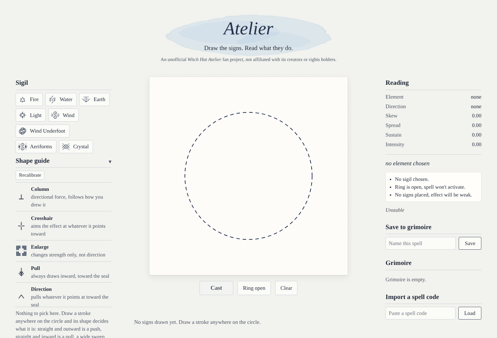
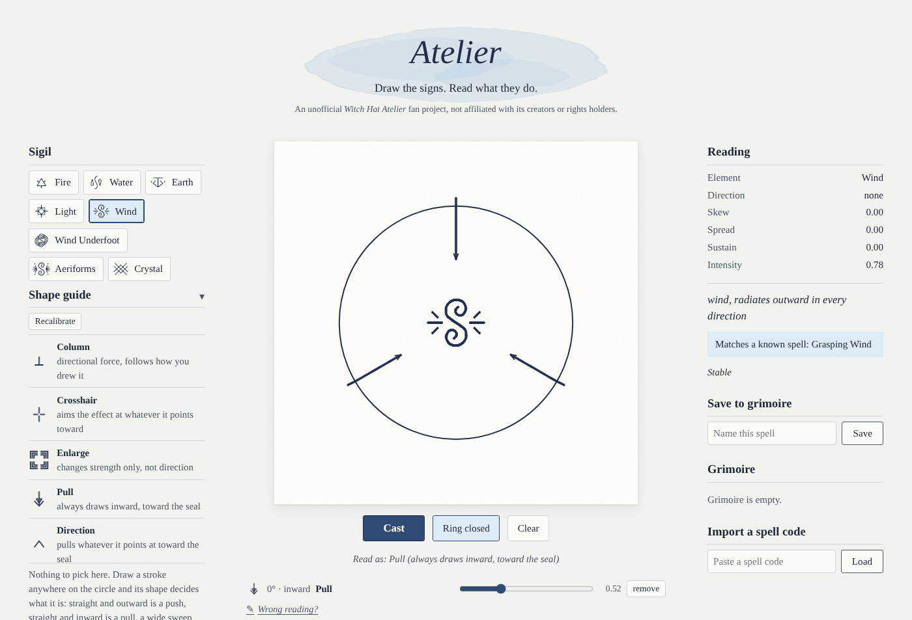
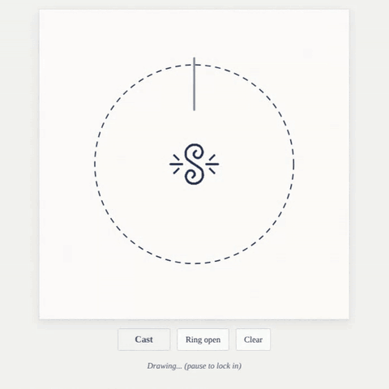
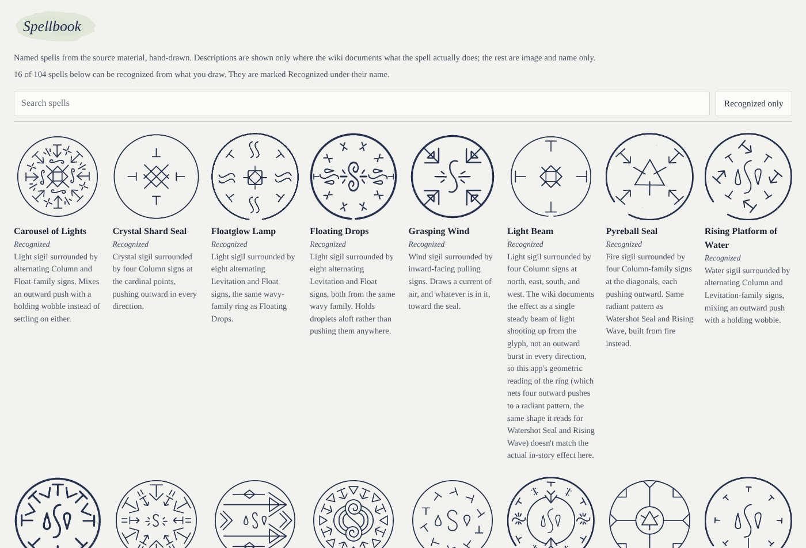
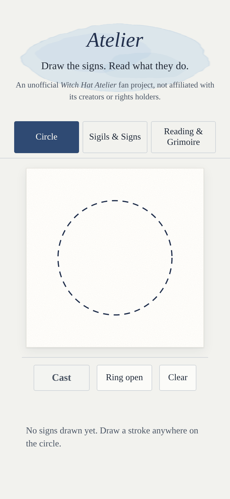

# Atelier

A spell circle workbench built on the magic system from *Witch Hat Atelier*: https://yatovoid.github.io/witch-atelier/

Pick an element, draw signs freehand anywhere on the circle, close the ring, and read what the spell resolves to. Then cast it and watch it play out on the circle.



Nothing is chosen for you before you draw. The shape of each stroke decides which sign it is: straight and outward is a push, straight and inward is a pull, a wide sweep spreads, a tight scribble crushes. Direction, spread, sustain and intensity are worked out from what you actually drew, so the same element behaves differently depending on the signs around it, and the cast animation follows those numbers instead of playing one fixed effect per element.





There are 8 elements and 24 signs. Recognition runs on the stroke geometry alone, in the browser, with no server and no model file, and a short calibration teaches it your handwriting. Drawn compositions are matched against 104 named spells from the series, and you can save your own spells to a grimoire and share them as a short code.



On a phone the three panels become tabs.



## How a stroke is read

Draw one or more strokes. A pause of about 1.4 seconds locks them in as one sign, so a sign made of a few parts still counts as one. The shape picks the family:

| Shape | Family |
|---|---|
| straight, drawn outward | Column, Crosshair, Enlarge, or Levitation |
| straight, drawn inward | Pull |
| wide sweep, outward | Dispersion, Radial, Rain, Billowing, or Weave |
| wide sweep, inward | Convergence, Window, or Collection |
| gentle wiggle that doesn't travel far | Float, Dancing Puppet, or Vision |
| sharp zigzag | Bolt, Bend, Direction, or Bird |
| closed loop, smooth | Diamond, Repetition, or Eye |
| closed loop, chaotic | Crush |

The source material doesn't draw the signs in one family any differently either, so the stroke narrows it to a family and the dropdown on its row picks the member.

Closedness comes straight from the geometry. Inward or outward compares how far the longest stroke's start and end sit from the ring's center, so a decoration drawn as its own stroke can't flip it. Everything else goes through the $1 Unistroke Recognizer (Wobbrock, Wilson & Li, 2007): the stroke is resampled, recentered, rescaled and rotated, then matched against reference examples. Angular spread is only checked when that match isn't confident, to catch a real wide sweep without mistaking a long zigzag for one.

## Limits

- One ring and one sigil per circle.
- Recognition is template matching, not a trained model, so clean, deliberate strokes work best.
- 16 of the 104 spellbook entries can be recognized from a drawing. The rest are reference images, because their sign composition isn't confirmed well enough to match against.
- The cast animation is my interpretation, not a copy of the manga's or the anime's effects.

## Files

| File | What it does |
|---|---|
| `js/engine/classify.js` | Reads a sign's strokes and returns its family and default member. Takes an optional pool of extra templates from `js/training.js`. |
| `js/data/templates.js` | Reference strokes for the matcher: geometric ones, ones traced off the glyph art in `assets/signs/`, and real hand-drawn ones. Add one here to fix a shape that keeps being misread. |
| `js/training.js` | Personal corrections saved in `localStorage`. "Wrong reading?" on a sign's row saves the stroke as an extra template for shape-matched families. |
| `js/data/signatures.js` | Recognizes a drawing as a named spell, for spells whose composition is confirmed on the wiki or readable from the reference art. |
| `js/data/sigils.js` | The 8 elements. |
| `js/data/signs.js` | The 24 signs, each with a `contribute()` function for its effect on direction, spread, sustain or intensity. Where the wiki doesn't say what a sign does, the entry says so. |
| `js/data/spellbook.js` | The 104 named spells. Descriptions only where the wiki documents the effect. |
| `js/engine/compose.js` | Turns the sigil and signs into the resolved numbers and misfire warnings. |
| `js/engine/render.js` | Draws the circle, the ink and the cast. |
| `js/engine/vector.js` | Angle and compass math. |
| `js/grimoire.js` | Saving spells and the spell code import and export. |

To add an element, add it to `SIGILS` in `js/data/sigils.js`. To add a sign, add it to `SIGN_ARCHETYPES` in `js/data/signs.js` and to `SIGN_BUCKETS` in `js/engine/classify.js`. To add a spell, add a row to `SPELLBOOK` in `js/data/spellbook.js`.

## Running it

It's plain HTML, CSS and JavaScript with no build step.

```
python3 -m http.server 8000
```

Then open http://localhost:8000. `node test/run.js` runs the recognition tests: every sign family at several positions around the ring, hand tremor, real misread drawings, and every named spell against its recipe and near misses.

## Fan project

This is an unofficial fan project. It isn't affiliated with or endorsed by the creators, publishers or rights holders of *Witch Hat Atelier*. The sigils, signs and spell names are fan interpretations, and the glyphs in `assets/` are redrawn reconstructions, not traced from the published pages.

The code is MIT licensed (see `LICENSE`). The characters, world and terminology belong to their rights holders.
